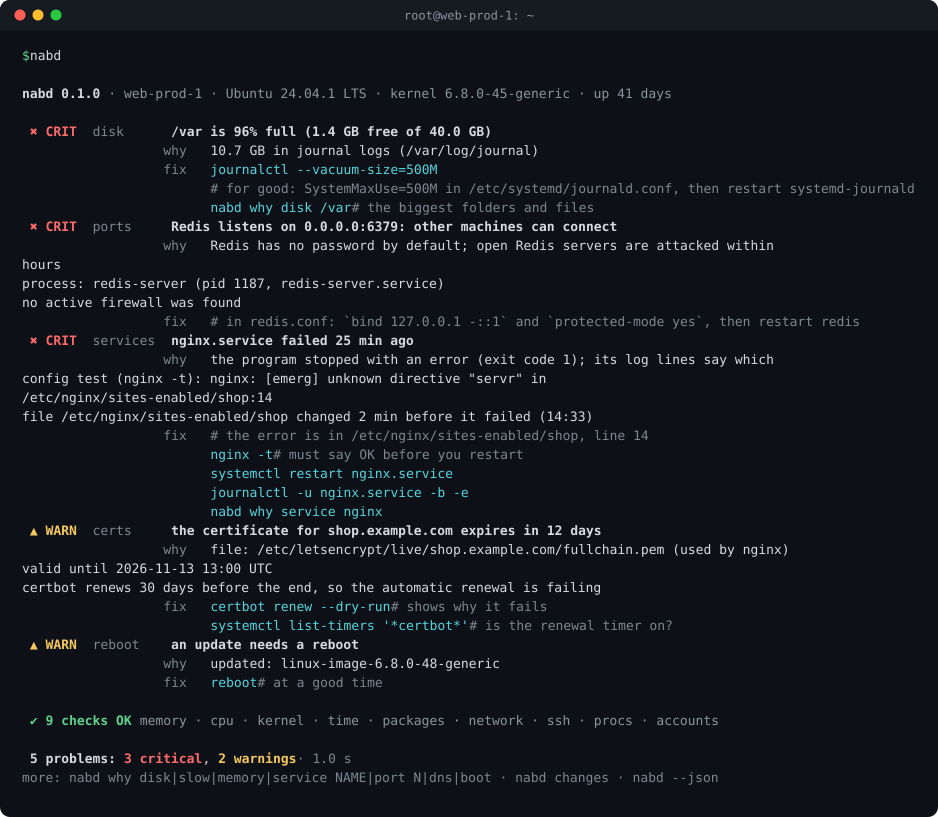

# nabd

[](https://github.com/s0sta/nabd/actions/workflows/ci.yml)
[](https://github.com/s0sta/nabd/actions/workflows/packaging.yml)
[](https://github.com/s0sta/nabd/releases/latest)
[](LICENSE)

**A doctor for Linux servers.** One command checks the whole machine, tells you in plain words what is wrong and why, and prints the command that fixes it.

<p align="center">
  
</p>
<p align="center"><sub>A demo server from the test suite (<a href="cmd/nabd/demo_test.go"><code>cmd/nabd/demo_test.go</code></a>). Every line is real nabd output.</sub></p>

nabd (نبض, Arabic for *pulse*) looks at disks, memory, CPU, services, the kernel log, time, reboots, packages, network, open ports, SSH, TLS certificates, processes and accounts. The checks run in parallel and take about a second. nabd only reads: it never changes your system.

## Why nabd

When a server is in trouble, the answer is spread over a dozen tools: `df`, `du`, `free`, `systemctl`, `journalctl`, `ss`, `openssl`, `dmesg`, `last` … You must know which one to ask, and how to read its answer. nabd asks all of them and connects the dots:

> **nginx.service failed 25 min ago.** The config test says `unknown directive "servr"` in `/etc/nginx/sites-enabled/shop`, line 14. That file changed 2 minutes before the failure.

- **Answers, not data.** Every problem comes with its cause and the exact fix. Healthy areas take one line.
- **Safe on production.** Read-only. No daemon, no agent, no config file, no network traffic (only `nabd why dns` sends DNS queries, and it tells you).
- **No root needed.** As a normal user it shows what it could not see. `sudo nabd` sees everything.
- **One static binary.** About 5 MB, no dependencies: Go standard library only. Debian, Ubuntu, RHEL, Rocky, Alma, Fedora, Arch, openSUSE, Alpine; with or without systemd; VM, bare metal or container.
- **Never hangs.** Every check has a time limit. A dead NFS mount gives you a finding, not a frozen terminal.
- **Made for automation too.** Nagios exit codes, stable JSON, Prometheus metrics, Markdown for tickets.

## Install

From the [latest release](https://github.com/s0sta/nabd/releases/latest): packages and static binaries for amd64, arm64, armv7, 386, ppc64le, s390x and riscv64.

```sh
# Debian, Ubuntu
curl -fLO https://github.com/s0sta/nabd/releases/latest/download/nabd_amd64.deb
sudo apt install ./nabd_amd64.deb

# Fedora, RHEL, Rocky, Alma, openSUSE
sudo rpm -Uvh https://github.com/s0sta/nabd/releases/latest/download/nabd_amd64.rpm

# Alpine
curl -fLO https://github.com/s0sta/nabd/releases/latest/download/nabd_amd64.apk
sudo apk add --allow-untrusted ./nabd_amd64.apk

# Any Linux: one static binary
curl -fL https://github.com/s0sta/nabd/releases/latest/download/nabd_linux_amd64.tar.gz | tar -xz nabd
sudo install -m 755 nabd /usr/local/bin/
```

Use `arm64`, `armv7`, `386`, `ppc64le`, `s390x` or `riscv64` instead of `amd64` for other machines. Every file is listed in `SHA256SUMS` and has a signed build provenance:

```sh
gh attestation verify nabd_amd64.deb --repo s0sta/nabd
```

From source (Go 1.19 or newer):

```sh
go install github.com/s0sta/nabd/cmd/nabd@latest
# or, with the man page, completions and systemd units:
git clone https://github.com/s0sta/nabd && cd nabd && make && sudo make install
```

## Use it

### Check everything

```sh
nabd          # the report
sudo nabd     # see everything: other users' processes, /etc/shadow, sshd -T …
nabd -v       # also list the checks that are OK
nabd -q       # only problems, no notes
```

### Ask why

| Command | What it answers |
|---|---|
| `nabd why disk [PATH]` | What fills the disk: the biggest folders and files, logs, caches, container images, deleted files that a process still holds open |
| `nabd why slow` | What slows the machine **now**: CPU, memory, the disk, a network file system or the hypervisor (steal), and which process |
| `nabd why memory` | Who uses the memory, OOM kills, swap, tmpfs |
| `nabd why service NAME` | Why a service stopped: what the exit code means, the config test, what changed just before, the last log lines |
| `nabd why port N` | Who listens, from which package, which config sets it, who can connect, the firewall |
| `nabd why dns [NAME]` | Asks every DNS server and shows which one fails and how |
| `nabd why boot` | Slow units, failures, and whether the last shutdown was clean |

Short forms work too: `nabd why nginx`, `nabd why 443`, `nabd why /var`.

### What changed?

`nabd changes` builds a timeline from logs and file times: packages, files in `/etc`, SSH keys, cron tables, logins, reboots and failed services. Changes that touch security are marked with `!`. It needs no setup and no earlier snapshot.

```console
$ nabd changes --since 2d
nabd changes · last 2 days · web-prod-1

 Sat 31 Oct
  09:12   pkg    openssl upgraded 3.0.13-0ubuntu3.4 → 3.0.13-0ubuntu3.5
  09:12   pkg    libssl3t64 upgraded 3.0.13-0ubuntu3.4 → 3.0.13-0ubuntu3.5
  09:12   file   3 files in /etc changed by the package update
  23:40 ! key    SSH keys of root changed (/root/.ssh/authorized_keys)

 Sun 1 Nov
  14:33   file   /etc/nginx/sites-enabled/shop
  14:35 x svc    nginx.service failed: the program stopped with an error (exit code 1); its log lines say which

 2 packages · 2 files · 1 SSH key change · 1 service failure
 1 change marked ! touches security: check that you or your team made it
```

### Catch drift and intruders

A snapshot keeps what matters for security: users, admin group members, SUID files, open ports, enabled services, packages, firewall and SELinux state, kernel settings, and a hash of every file in `/etc`, SSH `authorized_keys` and cron tables.

```sh
sudo nabd snapshot                               # save the state now
sudo nabd diff                                   # what is different since then
sudo nabd diff --since 7d                        # compared with about a week ago
sudo systemctl enable --now nabd-snapshot.timer  # one snapshot a day
```

A new UID 0 account or a SUID file in `/tmp` or `/home` is critical. A new admin, open port, SSH key, sudoers change, enabled service, or a firewall that went off is a warning.

### Scripts and monitoring

| Option | For |
|---|---|
| `--json` | scripts and tools; the schema is stable (`nabd/1`, see [docs/output.md](docs/output.md)) |
| `--nagios` | Nagios, Icinga, NRPE |
| `--prometheus -o FILE` | node_exporter's textfile collector (written atomically) |
| `--md` | a ticket or a chat |
| `--only disk,certs`, `--skip cpu` | choose the checks |

Exit codes follow the Nagios plugin rule: `0` OK, `1` warning, `2` critical, `3` unknown. Ready-made systemd units and a Nagios example are in [contrib/](contrib/).

## What nabd checks

| Check | What it looks at |
|---|---|
| `disk` | Space and inodes on every local file system. For a full one it finds the cause: the journal, package caches, container images, crash dumps, big logs, or deleted files that a process still keeps open. |
| `memory` | Available memory (or the container limit), swap, memory pressure (PSI) and processes the kernel killed because memory ran out. |
| `cpu` | Load per CPU, CPU use, time spent waiting for the disk (iowait), CPU taken by the hypervisor (steal) and CPU pressure, with the busiest processes. |
| `services` | Failed systemd units with the reason in plain words (exit code, signal, timeout, OOM), the last log lines, the service's own config test, and the files or packages that changed just before it failed. Services that keep restarting. |
| `kernel` | Disk and file system errors, file systems that turned read-only, hardware (MCE/EDAC) errors and hung tasks in the kernel log of this boot. |
| `time` | Is the clock synchronised (systemd-timesyncd, chrony or ntpd)? A wrong clock breaks TLS, Kerberos, logs and cron. |
| `reboot` | A newer kernel or core library is installed but not running yet, or the running kernel was removed by an update. |
| `packages` | Interrupted dpkg runs, stale pacman locks, and how long ago updates were installed. |
| `network` | A default route, DNS servers, and a real DNS server behind a local address like 127.0.0.53. Sends no traffic. |
| `ports` | Databases, caches and admin APIs open to the network (Redis, MongoDB, Elasticsearch, Memcached, MySQL, PostgreSQL, the Docker API, telnet …), the process behind them and the firewall. |
| `ssh` | Empty passwords, root login with a password, and brute-force login attempts in the last hour. |
| `certs` | Certificates used by nginx, Apache, HAProxy, Postfix, Dovecot and Let's Encrypt: expired or expiring soon. Parsed by nabd itself, no openssl needed. |
| `procs` | Zombie processes and their parent, processes stuck in D state, processes close to their open-file limit, system-wide file and process limits. |
| `accounts` | Other accounts with UID 0 and accounts without a password. |

Every finding has a stable ID such as `disk.full` or `ports.exposed-6379`. The full list is in [docs/checks.md](docs/checks.md).

## Safe by design

- nabd never writes, deletes, restarts or installs anything. `nabd snapshot` writes only its own files (`/var/lib/nabd` as root, else `~/.local/state/nabd`); `-o FILE` writes only the file you name.
- It reads `/proc`, `/sys` and files in `/etc`, and runs only commands that read: `systemctl show`, `journalctl`, `timedatectl show`, `sshd -T`, and the config tests of your services (`nginx -t`, `apachectl -t`, `haproxy -c` …). Every command runs with `LC_ALL=C`, a time limit and a cap on its output.
- No telemetry. Nothing leaves the machine. Only `nabd why dns` sends DNS queries, and it says so.
- `--json` and `--md` output contain host details (hostname, users, ports). Read them before you share them.

## How it compares

nabd does not replace monitoring. It is the command you run when you log in to a server: the first minutes of an incident, a machine you take over, a daily health check.

| Tool | What it is for |
|---|---|
| Prometheus, Netdata, Zabbix | metrics over time, graphs and alerts; they need setup |
| Lynis | a deep security audit with hundreds of tests, for hardening |
| htop, glances | a live view of resources |
| **nabd** | one command, one answer: what is wrong now, why, how to fix it, and what changed |

They work well together: `nabd --prometheus` feeds node_exporter, and `nabd --nagios` runs under Icinga.

## For distributions

nabd is easy to package: one Go module with no dependencies, no cgo, and tests that need neither root nor network. Packaging for Debian, Fedora/EPEL, Arch and Alpine is in [packaging/](packaging/). See [PACKAGING.md](PACKAGING.md).

## Contributing

False alarms and missed problems are the most useful reports. Open an issue with the `nabd --json` output (remove what is private). Each check is a small Go function, tested against a fake machine; see [CONTRIBUTING.md](CONTRIBUTING.md).

## License

[MIT](LICENSE) © 2026 Hosam Hani ([s0sta](https://s0sta.com))
